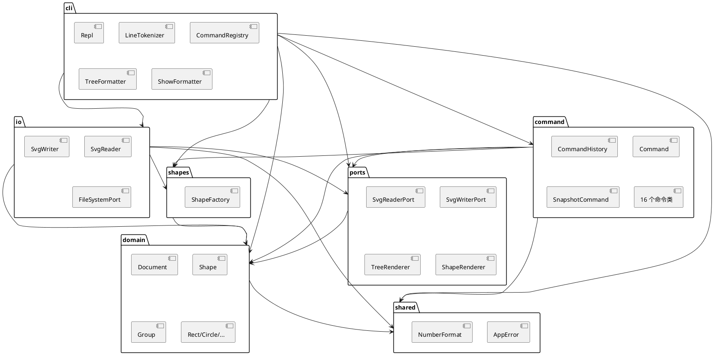

# Lab1 Phase 1：SVG 命令行编辑器

写代码之前先把结构定下来。这份文档会跟着实现改，最后的「一致性自查」等代码写完再回填，现在留空。

## 1. 架构

### 1.1 怎么分层

拆成五个业务层，另外两个小的辅助目录：

- `domain`：图形树本身。`Shape` 抽象基类、六个图形子类、`Document`（画布尺寸 + id 索引）。
- `command`：一次编辑封装成一个对象，负责「做什么」和「怎么撤回」。
- `io`：SVG 文本和领域对象之间的转换，外加文件读写。
- `cli`：分词、命令分发、输出格式化、REPL 循环。不放业务规则。
- `ports`：接口定义（读、写、渲染）。
- `shapes`：`ShapeFactory`，类型名到构造器的映射。
- `shared`：`AppError` 和数字格式化。

```
src/
├── domain/     Shape, Group, SvgRoot, Rect, Circle, Ellipse, Line, TextShape,
│               Document, IdAllocator
├── command/    Command, SnapshotCommand, CommandHistory, commands/（16 个）
├── ports/      Ports.ts（reader / writer / renderer 接口）
├── shapes/     ShapeFactory
├── io/         SvgReader, SvgWriter, FileSystemPort, NodeFileSystem
├── cli/        Repl, LineTokenizer, CommandRegistry, TreeFormatter,
│               ShowFormatter, HelpText
├── shared/     AppError, NumberFormat
└── index.ts    组装
```

模块职责和不该做的事：

| 模块 | 管什么 | 不管什么 |
|---|---|---|
| domain | 图形树、几何运算、id 唯一性、属性白名单、环检测 | 不读文件、不打印、不认识 `svg>` |
| command | 校验 + 修改 + 撤销数据 | 不解析命令行、不碰 stdout |
| ports | 三个接口 | 没有实现 |
| shapes | 类型名 → 图形对象 | 不含几何逻辑 |
| io | 序列化、反序列化、文件错误 | 不执行编辑、不维护 undo 栈 |
| cli | 输入输出 | 不直接改图形字段 |
| shared | 错误类型、数字格式化 | 不依赖业务模块 |

`domain` 坚持不依赖任何东西，是为了让大部分测试在没有任何 IO 的情况下就能跑完。如果哪天领域类里出现了 `readFileSync`，基本就是设计走歪了。

### 1.2 依赖图



（等代码写到一半，把这张图导成 PNG 放进 `doc/images/`，GitHub 不渲染 PlantUML 代码块。）

### 1.3 用到的模式

**Command**（作业要求必须用）。接口就四个成员：

```ts
export interface Command {
  readonly kind: 'edit' | 'io' | 'display';
  execute(document: Document): CommandResult;
  undo(document: Document): CommandResult;
  redo?(document: Document): CommandResult;
}
```

16 个具体命令类，每个类只管一件事。`CommandHistory` 是调用方：编辑命令执行完入栈，io 命令清空栈并上锁，显示命令直接执行完事。

为什么不用「一个 `switch (cmd)` 加一堆函数」：撤销需要记住现场。比如 `delete` 要记住原来挂在哪个父节点、第几个位置，函数式写法只能把这些状态塞进外部的 Map，写到最后大概率变成一个什么都管的类。

**Composite**。`Group` 和叶子图形都继承 `Shape`，`move` / `scale` / `set` / `delete` 不区分类型。有一处我犹豫过：容器的位移是写 `transform="translate(...)"`，还是递归改每个子节点的坐标？

选了后者。原因是 `tree` 和 `show` 显示的都是绝对坐标，写 transform 的话还得在展示时做换算，和作业里的 transcript 对不上。代价是以后要支持用户手动写 transform，`Group` 和 `SvgWriter` 都得改。这条记在变化点里。

**工厂**。`ShapeFactory` 内部一张 `Map<string, 注册信息>`，注册信息里带构造器和几何属性顺序。这是作业允许的两处按名分派之一（另一处是命令分发）。`box` 以后从同一个口进来。

**撤销用快照**。`SnapshotCommand` 在 execute 前克隆整篇文档，undo 时覆盖回去。最先想的是「逆操作」——move 就反向 move，scale 就除以 factor。后来想到浮点：`scale 1.1` 三次再除三次，得到的是 1.0000000000000002 这种数，`tree` 输出立刻就不对了。快照的代价是内存跟文档大小成正比，作业这个规模无所谓。

没用 Visitor。六种图形乘十几种操作，用访问者会膨胀成一个方法矩阵，而现在图形之间的差异用多态就够了。也没用 Singleton，全局状态换个名字还是全局状态。

### 1.4 依赖方向

| 允许 | 理由 |
|---|---|
| `cli → command / io / shapes / ports / domain / shared` | 外壳负责组装 |
| `command → domain / shapes / ports / shared` | 命令操作领域对象，通过端口读写文件 |
| `io → domain / shapes / ports / shared` | 读入要用工厂建对象 |
| `ports → domain` | 接口签名里有 `Document` |
| `shapes → domain / shared` | 工厂产出 `Shape` |
| `domain → shared` | 只用错误类型和数字格式化 |

| 禁止 | 理由 |
|---|---|
| `domain → 任何其它层` | 领域核心要能脱离终端和文件单测 |
| `command → cli` | 命令不该知道自己被谁触发 |
| `command → io` | 反过来也一样：命令依赖 `SvgReaderPort`，不依赖具体实现 |
| `io → command` | 序列化不是编辑动作，不能顺手改状态 |
| `cli` 直接改图形字段 | 一切变更都走命令，否则 undo 栈和实际状态会脱节 |

打算用 grep 自查，期望输出为空：

```bash
grep -rEn "from '\.\./(cli|command|io|shapes|ports)/" src/domain
grep -rEn "from '.*/cli/" src/command src/io
grep -rEn "from '\.\./command/" src/io
```

### 1.5 可能变的地方

| 变化 | 留的口子 | 或者为什么不留 |
|---|---|---|
| 加图形类型（box、path、第三方插件） | `ShapeFactory.register()`；读入侧复用同一张表的属性顺序 | — |
| 加命令（align、rotate、copy） | 一个类 + 注册一行，`SnapshotCommand` 直接复用 | — |
| 换存储格式（JSON、压缩包） | `domain` 里没有任何 XML 知识 | — |
| 换交互通道（HTTP、agent 调用） | `Repl` 只负责输入输出，`handleLine` 可以脱离 stdin | — |
| 大文档要省内存 | `CommandHistory` 只暴露 push/undo/redo，快照策略可换 | — |
| 容器改成写 transform | 决策点只有 `Group.move/scale` | 现在不做开关：两种语义下 `tree`、`show`、`save` 的输出全不一样，抽象成本比收益高 |
| 多文档 / 多人协作 | **不做** | 作业是单文档 + 线性撤销，多文档会让 `undo not allowed after io command` 的语义变得含糊，真要做是重新设计 |
| 国际化 / 彩色输出 | **不做** | 错误文案是评分点，逐条比对；彩色输出还会让 transcript 断言变麻烦 |

### 1.6 还没想好的几件事

写代码前先记下来，后面如果改了要回来更新：

1. **`tree` 的列宽**。作业 §5.1 和 §6.1 两个例子的空格数对不上（同一个例子里 `rect#start` 在第 29 列，`text#process-label` 在第 32 列）。打算统一成「最长的前缀+标签再加 2 个空格」，保证同一棵树对齐。
2. **`line` 的摘要**。§6.1 示例里没显示 `stroke=black`，但 rect/circle 都显示 fill。倾向统一显示样式，不为一个类型开特例。
3. **根级容器不能 `ungroup`**。§4.2 明写要报错，可 §6 里 `group markers c1 box` 造出来的容器就在根级，等于永远解不开。这是文档本身的矛盾，准备按字面实现，测试里写清楚。
4. **`save` 之后历史栈清不清**。§4.3 只说「undo 禁止，直到下一次编辑解禁」。清空更安全，避免撤销跨过保存点，先按清空做。
5. **`read` 丢属性**。只保留内核认识的属性和几何/样式，`transform` 和未知属性会丢。本阶段不要求完整 SVG 支持，先记着。

## 2. 过程记录

### 2.1 命令到底是 18 条还是 19 条

第一版方案里写「18 条命令」，后来按表数：文档类 4 条、编辑类 10 条、显示类 3 条、undo/redo 2 条，加起来 19。差的这一条不是笔误，是漏了 `canvas` 带参数时算 io 命令。教训是别凭印象报数，照表一个一个点。

### 2.2 `ungroup` 的坑

读 §4.2 时注意到「根级容器报 `cannot ungroup top-level container`」，再回头看 §6 的会话：`group markers c1 box` 之后 `g#markers` 就是根级。也就是说，这个容器建出来就再也解散不了。

一开始以为文档写错了，想「顺手放开根级」。后来想清楚：错误文案是评分点，§4.2 列得很死，改了就是自己给自己找麻烦。决定按字面实现，并且在测试里固定这个行为（`ungroup scene` 必须报错），免得以后自己忘了又去「修」。

### 2.3 undo 用快照

见 1.3。这里补一句当时的推演：`scale 2` 再 `undo` 用除法没问题，但 `scale 1.1` 连着三次，`1.1 * 1.1 * 1.1 = 1.3310000000000004`，除回去是 0.9999999999999999，`tree` 里就会出现 `x=9.999999`。与其在格式化时四舍五入掩盖，不如直接存快照。

### 2.4 插件系统先不做

第一版方案里画了 ShapeProvider 的插槽，甚至想好了 `register(provider)` 的签名。翻回 §4.4 看到「本阶段不要求实现」和「内核为此新增的代码为 0」，就把这块砍了，只保留 `ShapeFactory` 的注册入口和 `data-kind` 的读回说明。

理由很简单：插件契约要等 Phase 2 真的写 `box` 的时候才定得下来，现在设计大概率是猜，猜错了还要改内核。

### 2.5 端口为什么单独拆出来

写 `SvgReader` 的时候，它需要返回「文档 + 警告列表」，而这两个东西的类型定义在 `command/ports.ts`。这样 `io` 就 import 了 `command`，正好撞上「io 不能依赖 command」这条。

一开始想忍一忍，反正只是类型。后来觉得规则既然写进文档，就不能有例外，否则一致性自查没法交代。于是把端口抽成独立的 `ports` 模块，`command` 和 `io` 各自依赖接口，谁也不依赖谁。

### 2.6 AI 给的初稿哪里不对

架构初稿是让模型先列一版的，里面有几处明显要改：

- 它把 `tree` / `show` 的格式化放进了命令层，结果 `command` 需要 import `cli`。改成命令只接收一个渲染函数（`TreeRenderer` / `ShapeRenderer`），实现在 cli 层注入。
- 它默认「容器用 transform 表示位移」，但这和 `tree` 显示绝对坐标的要求冲突（见 1.3）。
- 它建议在 Phase 1 就把插件加载器写完，翻了 §4.4 之后否掉。

这几条不是模型「写错了代码」，而是它在没看到作业原文约束的情况下做了合理但不对的假设。所以流程改成：先让它读作业原文，再让它给方案，最后自己逐条对着文档核。

## 3. 一致性自查

等代码写完，对着上面的方案逐条填，不写「基本一致」。

| 检查项 | 结论 | 证据 |
|---|---|---|
| 实际目录与 1.2 的图是否一致 | 待填 | |
| 不一致处有没有记进修订记录 | 待填 | |
| 是否一类一文件、文件名 = 类名 | 待填 | |
| 有没有贫血模型 / 满屏 `switch` | 待填 | |
| 依赖方向有没有被违反 | 待填 | |
| 按名分派是不是只有两处 | 待填 | |

## 4. 质量保证

### 4.1 测试怎么分层

- `tests/domain`、`tests/command`：纯内存，断言对象状态，不碰磁盘。
- `tests/io`：用内存文件系统（`MemoryFileSystem implements FileSystemPort`），测序列化、反序列化、round-trip。
- `tests/cli`：分词、格式化、参数校验、REPL。REPL 的 `handleLine` 返回字符串数组，直接断言，不需要真的开终端。
- `tests/acceptance`：回放作业 §6 的两段会话，逐行比对输出；错误文案单独一张表，每条一个用例。

### 4.2 TDD 的节奏

每个模块先提交一个只有测试、且测试是红的提交，再提交实现让它变绿。大概分六步：

1. `shared`：数字格式化、错误类型
2. `domain`：Shape 层次、Composite、Document 快照
3. `command`：Command 接口、History、16 个命令
4. `io`：读写、缺 id 补全
5. `cli`：分词、分发、格式化、REPL
6. 验收：transcript 回放 + 错误文案

### 4.3 怎么算写完了

- 作业 §6 和 §6.1 两段会话能原样跑出来；
- §4.2 的每条错误文案都有对应用例；
- 命令的正常路径、撤销、错误路径各至少一条测试；
- `npm test`、`npm run typecheck` 全绿，覆盖率不低于 85%；
- `save` 出来的 SVG 拖进浏览器能正常显示。

## 5. 修订记录

| 版本 | 日期 | 改了什么 |
|---|---|---|
| v0.1 | 2026-10-25 | 初稿：分层、依赖规则、变化点、待定问题 |
